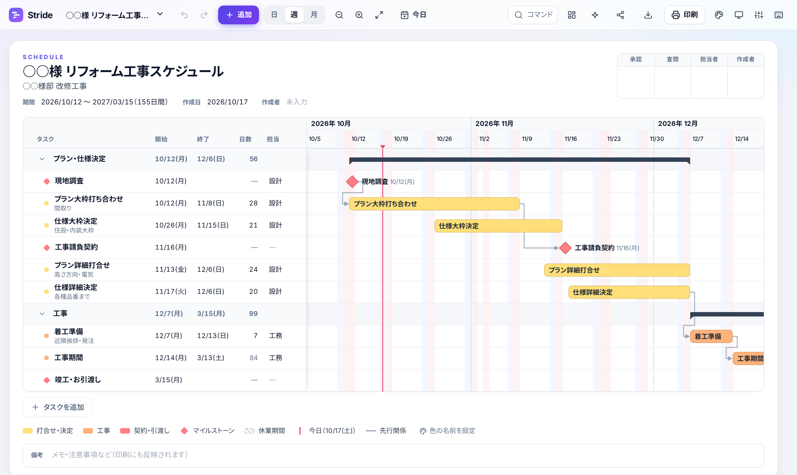

# Stride — おしゃれな工程表・ガントチャート

ブラウザだけで使える、日本の実務向けガントチャート作成ツールです。インストールもログインも不要で、データは自分のブラウザ内に保存されます。



## 主な機能

### 作る
- **ドラッグ操作**：バーを動かすと移動、両端を動かすと期間を変更
- **テンプレート**：リノベーション、中古を買ってリノベーション、不動産売買、白紙
- **テキストから一括作成**：`プラン打合せ 10/9-11/5 (間取り) @設計` のように1行ずつ書くと、まとめてタスクになる
- **Excel / CSV の読み込み**（「タスク名・開始・終了」などの列を自動で判別）
- **分割バー**：1つのタスクに複数の期間を設定できる（例：正月休みをはさんだ工事期間）
- **マイルストーン**（◆）と、折りたためる**見出し**

### 管理する
- **先行関係の矢印**：バー右端の ○ を別のバーへドラッグするとつながる。日程が矛盾している矢印は赤い点線になる
- **後続タスクの自動調整**：先行タスクを後ろにずらすと、後続のタスクも自動で後ろにずれる
- **日本の祝日を自動表示**（振替休日・国民の休日を含む）、土日の色分け
- **休業期間**（年末年始・お盆など）を斜線で表示
- **稼働日の計算**（定休日は土日祝／日祝／なしから選択）
- 進捗率、担当者、補足、凡例（色ごとに名前を付けられる）

### 見せる・出す
- **印刷**：A4 / A3 / B4、横・縦。全期間が1ページに収まるように自動で縮小
- **PDF・PNG のダウンロード**
- **Excel 出力**：タスク一覧と、セルに ■ を並べたチャートの2シート
- 押印欄（承認・査閲・担当者・作成者。項目は変更可）、備考欄
- **共有リンク**：チャートのデータをURLに埋め込んで共有（サーバーには保存されない）

### 保存して、あとで開く
- **ファイルに保存**（Ctrl＋S）：パソコンの好きなフォルダに `.stride.json` として保存。2回目以降は同じファイルに上書きされ、編集するたびに自動でファイルにも保存される
- **ファイルを開く**（Ctrl＋O）、**名前を付けて保存**（Ctrl＋Shift＋S）
- **保存フォルダ**：フォルダを1つ決めておくと、その中のスケジュールを一覧から開ける。OneDrive・Box・Google ドライブの同期フォルダを選べば他のパソコンからも使える
- フォルダへの直接保存は Chrome / Edge で使えます。それ以外のブラウザではダウンロードフォルダに保存されます

### 快適に使う
- 日・週・月の表示切り替えとズーム（Ctrl＋ホイール）
- 元に戻す / やり直し、自動保存、複数のスケジュールを切り替え
- **コマンドパレット**（Ctrl＋K）とキーボードショートカット（? で一覧を表示）
- 5種類のカラーテーマ、ダークモード
- スマートフォン対応、PWA（ホーム画面に追加すればオフラインでも使える）

## データについて

- 作成したデータはブラウザの `localStorage` に自動保存されます。「ファイルに保存」を使うと、パソコンのファイルにも保存されます。どちらも外部に送信されることはありません。
- 共有リンクは、圧縮したデータをURLの `#` 以降に入れています。URL の `#` 以降はサーバーに送信されません。
- バックアップを取るときは「書き出し → JSON」を使ってください。

## 技術構成

ビルド不要の静的サイトです（HTML / CSS / ES Modules）。

| ファイル | 内容 |
| --- | --- |
| `js/app.js` | 描画（SVG）、操作、UI |
| `js/holidays.js` | 日本の祝日の計算 |
| `js/files.js` | パソコンのファイル・フォルダへの保存と読み込み（File System Access API） |
| `js/io.js` | PDF・PNG・Excel・CSV・JSONの入出力、共有リンク、テキストの解析 |
| `js/templates.js` | テンプレート |
| `sw.js` | オフライン対応 |

PDF・PNG・Excel の書き出しを最初に使うときだけ、cdnjs から [html2canvas](https://html2canvas.hertzen.com/)、[jsPDF](https://github.com/parallax/jsPDF)、[SheetJS](https://sheetjs.com/) を読み込みます。

ローカルで動かす場合：

```bash
python3 -m http.server 8000
# → http://localhost:8000
```
